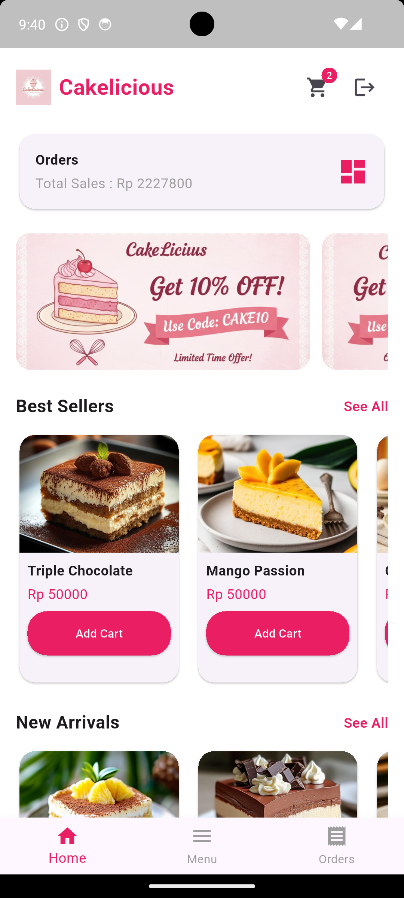
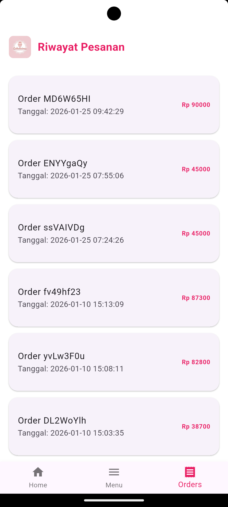
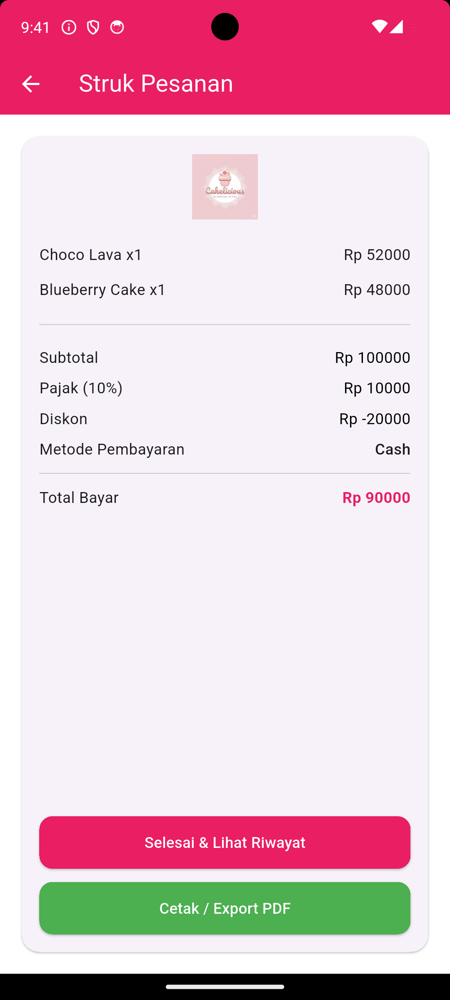

# 🍰 Cakelicious — Cake Ordering App

Cakelicious is a mobile cake ordering application built with Flutter and Dart. The application is designed to provide users with a convenient way to browse cakes, manage their shopping cart, and complete orders through a simple and user-friendly interface.

## 📱 Application Preview

_Add screenshots of the application here._

Recommended screenshots:
- Home & Product Catalog
- Shopping Cart & Checkout
- Order Receipt

## ✨ Features

- **Product Catalog** — Browse available cakes and product prices.
- **Shopping Cart** — Manage selected products before checkout.
- **Order Management** — View order details and order history.
- **Checkout** — Review subtotal, tax, discounts, and final payment.
- **Payment Method Selection** — Select an available payment method.
- **Discount Code** — Apply promotional codes during checkout.
- **Order Receipt** — View order summaries and export receipts to PDF.
- **User Authentication** — Login and registration screens.

## 🛠️ Tech Stack

- **Flutter** — Cross-platform mobile application framework.
- **Dart** — Primary programming language.
- **Firebase** — Backend services and configuration used in the project.

## 🗂️ Project Structure

```text
cakelicious/
├── android/
├── assets/
├── ios/
├── lib/
│   ├── screens/
│   ├── services/
│   ├── widgets/
│   └── main.dart
├── test/
├── web/
├── windows/
├── pubspec.yaml
└── README.md
```

## 🚀 Getting Started

### Prerequisites

- Flutter SDK
- Dart SDK
- Android Studio or Visual Studio Code
- A configured Firebase project, if required by the application

### Installation

1. Clone the repository:

   ```bash
   git clone https://github.com/RifqiAiniWahdaniyatillahi/Cakelicious.git
   ```

2. Navigate to the project directory:

   ```bash
   cd Cakelicious
   ```

3. Install dependencies:

   ```bash
   flutter pub get
   ```

4. Run the application:

   ```bash
   flutter run
   ```

Follow the project's Firebase configuration requirements before running the application if Firebase services are enabled.

## 🎯 Project Purpose

This project demonstrates practical experience in Flutter mobile application development, user interface implementation, shopping cart workflows, order processing, and receipt generation.

## 📱 Application Preview

### Home & Product Catalog


### Shopping Cart & Checkout


### Order Receipt


## 👨‍💻 Developer

**Rifqi Aini Wahdaniyatillahi**

S1 Informatics Engineering graduate interested in IT Business Analysis, Web Development, UI/UX Design, and user-centered digital solutions.

---

*This repository is part of my software development portfolio.*
